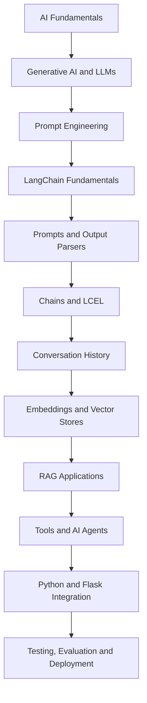
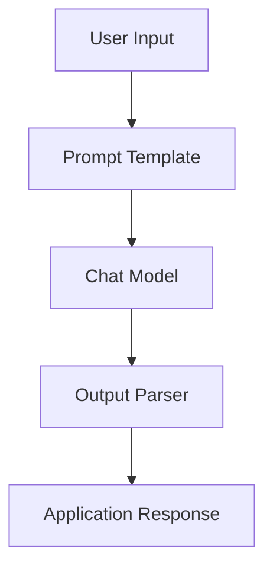
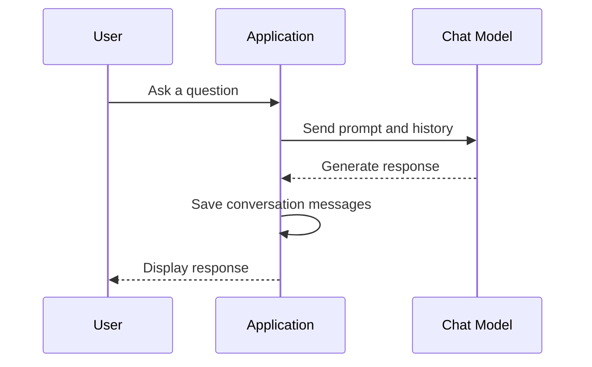
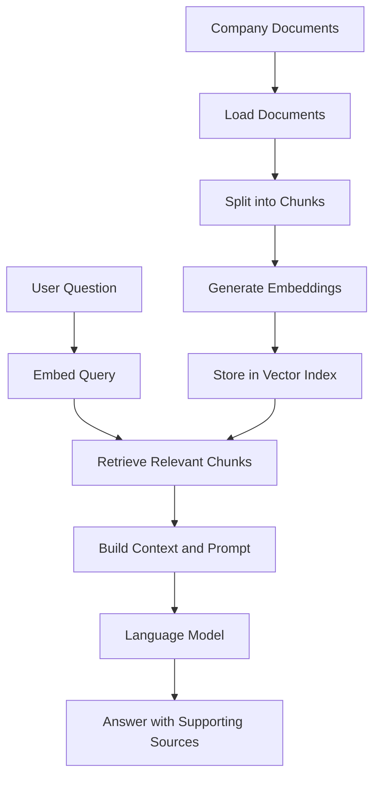
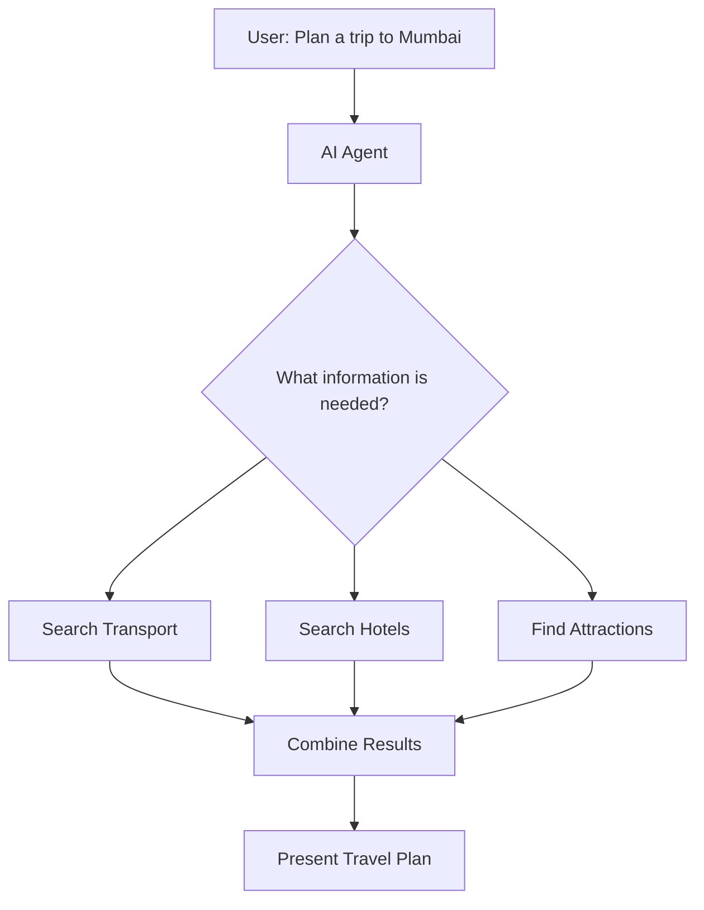
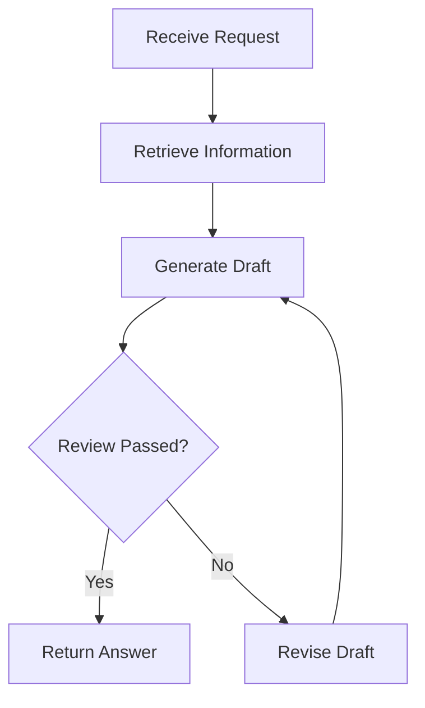
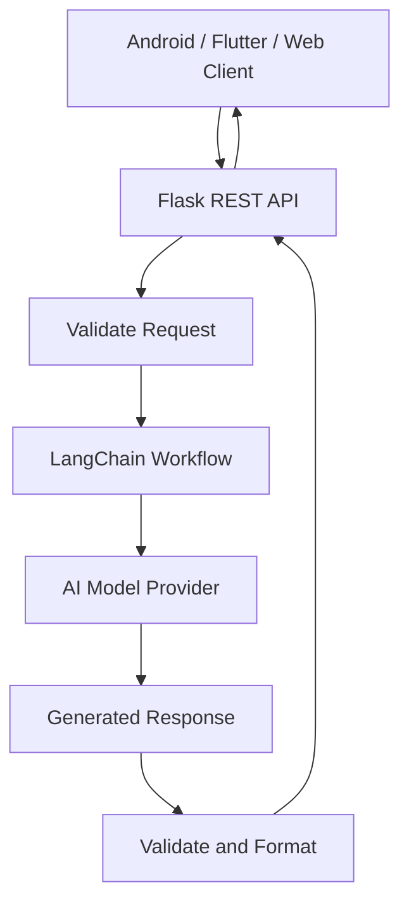

# 🤖 How Large Language Models (LLMs) Work

A beginner-friendly guide to understanding how Large Language Models (LLMs) process human language, learn patterns, and generate AI-powered responses.

## 📌 Introduction

A **Large Language Model (LLM)** is an Artificial Intelligence (AI) model trained on large amounts of text to understand language patterns and generate human-like responses.

LLMs power applications such as ChatGPT, AI chatbots, coding assistants, document summarizers, and intelligent virtual assistants.

Unlike traditional software that relies entirely on explicitly programmed rules, LLMs learn patterns from training data and use those patterns to predict suitable responses.

**Examples of LLM-powered applications:**
- ChatGPT — conversational AI
- GitHub Copilot — AI-assisted programming
- AI customer support chatbots
- Document summarization and question-answering systems
- AI assistants integrated into mobile applications

---

## 🔄 How Does an LLM Work?

An LLM processes input text, converts it into numerical representations, analyzes contextual relationships, and generates a response one token at a time.

### Overall Workflow

```text
User Input
    |
    v
Tokenization
(Split text into tokens)
    |
    v
Token IDs and Embeddings
(Convert tokens into numerical representations)
    |
    v
Transformer Layers
(Process information and context)
    |
    v
Attention Mechanism
(Understand relationships between tokens)
    |
    v
Next-Token Prediction
(Predict the next token)
    |
    v
Response Generation
(Repeat until the response is complete)
```

> **Important:** Attention and transformer processing work together. Attention is a component of transformer layers, not necessarily a separate stage that runs only after all transformer layers.

---

## 1️⃣ Tokenization

**What is tokenization?**

Tokenization is the process of breaking text into smaller pieces called *tokens*.

A token can represent:
- A complete word
- Part of a word
- Punctuation
- A number or other text element

For example, the sentence:

```text
Hello, how are you?
```

Might be divided into tokens resembling:

```text
["Hello", ",", " how", " are", " you", "?"]
```

The exact token boundaries depend on the tokenizer used by the model.

Each token is mapped to a numerical ID so the model can process it.

**Why is tokenization important?**

Computers process numerical data. Tokenization converts human-readable text into units that can be represented and processed mathematically.

**Real-world example:**

When you enter a question into ChatGPT, the input text is tokenized before being processed by the language model.

**Explore:** [Tiktokenizer](https://tiktokenizer.vercel.app/) — visualize how text is divided into tokens.

---

## 2️⃣ Embeddings

**What are embeddings?**

Embeddings are numerical vectors that represent tokens in a mathematical space.

For example, a token might be represented internally by a vector containing hundreds or thousands of numerical values, depending on the model.

A simplified illustration:

```text
"Cat"     → [0.21, 0.45, 0.78, ...]
"Dog"     → [0.25, 0.41, 0.73, ...]
"Airplane"→ [0.82, 0.12, 0.34, ...]
```

These numbers are illustrative, not actual model embeddings.

During training, embeddings and other model parameters learn representations that help the model process linguistic patterns and relationships.

**Why are embeddings important?**

They provide a numerical representation that the neural network can transform and use to interpret contextual relationships.

**Real-world example:**

In a semantic search application, a user searches for "ways to improve sleep." An embedding-based search system may retrieve a document titled "Tips for better rest" because the meanings are related, even though the wording differs.

**Explore:** [Nomic Atlas](https://atlas.nomic.ai/) — explore ways of visualizing embeddings and data relationships.

---

## 3️⃣ Attention Mechanism

**What is attention?**

Attention helps a transformer determine which other tokens are relevant when processing a particular token.

Consider this sentence:

```text
The developer fixed the bug because it caused the app to crash.
```

To interpret the word "it," the model can use relationships between tokens to associate it with "the bug."

Attention calculates relationships between token representations using learned parameters.

### Self-Attention

Self-attention allows tokens in a sequence to incorporate information from other relevant tokens.

For example:

```text
The cat sat on the mat.
    |       |
    +-------+
 Relationship between the subject and action
```

The model can learn that "cat" is associated with the action "sat."

Transformers use multiple attention heads to learn different types of relationships in parallel.

**Why is attention important?**

Without contextual information, a word can have several meanings. Attention helps the model interpret words based on their surrounding context.

**Real-world example:**

A customer asks:

"I ordered a phone, but it arrived damaged. Can I return it?"

Attention helps the model connect "it" with the phone and interpret the user's return request.

---

## 4️⃣ Transformer Architecture

**What is a transformer?**

A transformer is a neural network architecture that uses attention and other computational layers to process sequences of tokens.

Transformers are the foundation of many modern LLMs.

A simplified transformer block contains:

1. Self-attention
2. A feed-forward neural network
3. Residual connections
4. Layer normalization

These components work together across multiple layers to transform token representations.

### Simplified Architecture

```text
Input Token IDs
      |
      v
Token Embeddings
      |
      v
Transformer Block 1
  - Self-Attention
  - Feed-Forward Network
      |
      v
Transformer Block 2
  - Self-Attention
  - Feed-Forward Network
      |
      v
More Transformer Blocks
      |
      v
Output Scores for Vocabulary Tokens
      |
      v
Next-Token Selection
```

Real transformer architectures may include additional components and implementation-specific variations.

**Why are transformer layers important?**

Different layers progressively transform information, allowing the model to learn complex patterns in language and context.

**Real-world example:**

When a coding assistant examines a function, transformer layers help it process relationships among variable names, function calls, comments, and surrounding code to generate a contextually relevant suggestion.

---

## 5️⃣ Next-Token Prediction

**What is next-token prediction?**

Next-token prediction is the central training objective of many generative LLMs.

The model estimates which token should come next, given the preceding context.

For example:

```text
Input:  The capital of France is
Next:   Paris
```

After selecting "Paris," the model can predict what comes next if the response continues.

For an actual question-answering system, the input also includes the user's question and any relevant conversation or instructions.

**Why is next-token prediction powerful?**

Learning to predict tokens across diverse text helps the model learn grammar, factual associations, writing styles, and other useful patterns.

However, next-token prediction does not guarantee that every generated statement is correct.

**Real-world example:**

A coding assistant receives:

```python
def add(a, b):
```

It may predict the following code:

```python
    return a + b
```

The model generates the code token by token, based on the input context and learned patterns.

---

## 6️⃣ Training a Large Language Model

**What is training?**

Training is the process through which a model learns patterns by adjusting its internal parameters.

A simplified training workflow:

```text
Training Text
     |
     v
Tokenization
     |
     v
Model Predicts Next Tokens
     |
     v
Compare Predictions with Training Targets
     |
     v
Calculate Prediction Error (Loss)
     |
     v
Backpropagation
     |
     v
Update Parameters Using an Optimizer
     |
     v
Repeat Many Times
```

### Important Training Concepts

- **Training data:** Text and other supported data used to teach the model.
- **Parameters:** Learned numerical values inside the neural network.
- **Loss:** A measure of how poorly the model predicts its training targets.
- **Backpropagation:** Computes gradients that indicate how parameters contributed to the error.
- **Optimizer:** Uses gradients to update the parameters.
- **Compute infrastructure:** GPUs or other specialized hardware used to perform large-scale calculations.

Large-scale training can require enormous datasets, substantial computing resources, and extensive engineering.

After initial training, some models undergo additional stages, such as supervised fine-tuning and preference-based alignment, to improve their usefulness and behavior.

**Real-world example:**

A language model learns from many examples of questions and answers, articles, and code. During training, it adjusts its parameters to improve its predictions. The resulting model can then be used for tasks such as answering questions and assisting with programming.

---

## 7️⃣ Inference: Generating an Answer

**What is inference?**

Inference is the process of using a trained model to produce an output.

Training teaches the model. Inference uses what the model has learned.

For many generative LLMs, response generation works as follows:

1. Receive the input prompt and relevant context.
2. Tokenize the input.
3. Process the tokens through the model.
4. Calculate scores or probabilities for possible next tokens.
5. Select a token according to the decoding strategy.
6. Append the token to the generated sequence.
7. Repeat until a stopping condition is reached.

### Example

```text
Prompt:
Explain Android Jetpack Compose.

Generated response:
Android Jetpack Compose is a modern toolkit
for building native Android user interfaces...
```

The model generates the response incrementally, rather than necessarily producing the entire answer in one prediction.

### What Is Temperature?

Temperature is a generation setting that influences how the model selects among possible next tokens.

- **Lower temperature:** Generally favors higher-probability choices and more predictable output.
- **Higher temperature:** Generally allows more varied and less predictable output.

Temperature does not add knowledge to the model or guarantee creativity or correctness.

**Real-world example:**

A technical support assistant may use relatively conservative generation settings for consistent answers, while a creative writing assistant may allow more variation.

---

## 🌍 Real-World Example: Building an AI Customer Support Assistant

Imagine an e-commerce company wants to build an AI assistant that answers questions about orders and returns.

### User Question

```text
"My headphones arrived damaged.
Can I return them?"
```

### How the System Works

**Step 1: Receive the question**

The application sends the user's message to the AI system.

**Step 2: Tokenize the input**

The text is divided into tokens and converted into token IDs.

**Step 3: Process the context**

The transformer processes the input and uses attention to understand the relationships between the damaged headphones and the return request.

**Step 4: Retrieve relevant information if needed**

A retrieval system may search the company's return policy or order database. This is an additional application-level capability, not an automatic feature of every LLM.

**Step 5: Generate the response**

The model uses the available context to generate a helpful answer.

**Step 6: Display the answer**

For example:

```text
"I'm sorry your headphones arrived damaged.
According to our return policy, damaged items
may qualify for a return. Please provide your
order number so we can check your eligibility."
```

This is an illustrative response. A real system should verify the applicable policy and order details before making definitive claims.

### Technologies That Could Be Used

| Component | Example technologies |
|---|---|
| Mobile application | Android, Kotlin, Flutter |
| Backend API | Python, Flask, FastAPI, Node.js |
| Language model | OpenAI API or another compatible LLM service |
| Retrieval | Embeddings and a vector database |
| Business data | SQL or a company order-management API |
| Security | Authentication, authorization, and data protection |

**Important:** The LLM generates language. The surrounding application connects it to verified order data, business rules, and authorized actions.

---

## 📱 Real-World Example: Integrating an LLM into an Android or Flutter App

Suppose you are building a mobile learning assistant that explains programming concepts to beginners.

### Application Workflow

```text
Android / Flutter App
        |
        v
User Enters a Question
        |
        v
Application Sends API Request
        |
        v
Backend or LLM Service
        |
        v
LLM Processes the Prompt
        |
        v
Response Generated
        |
        v
App Displays the Explanation
```

### Example Use Cases

- Explain Kotlin, Java, Dart, and Python concepts.
- Generate quizzes for programming learners.
- Summarize technical documentation.
- Answer questions about uploaded learning materials.
- Provide contextual coding assistance.

### Example API Interaction

A mobile app could send a request to a backend service using an HTTP POST request.

Illustrative request body:

```json
{
  "question": "Explain Kotlin coroutines in simple words",
  "audience": "beginner"
}
```

The backend can combine the question with appropriate instructions, call an LLM service, and return the generated answer to the app.

**Security best practice:** Do not embed a private LLM API key directly in a publicly distributed mobile application. Keep secret credentials on a secure backend and apply authentication, authorization, rate limits, and appropriate data-handling controls.

---

## 🧠 Important LLM Concepts at a Glance

| Concept | Simple meaning |
|---|---|
| LLM | AI model trained to process and generate language |
| Token | A piece of text processed by the model |
| Tokenization | Breaking text into tokens |
| Token ID | Numerical identifier assigned to a token |
| Embedding | Vector representation of a token or other data |
| Attention | Mechanism for incorporating information from relevant tokens |
| Transformer | Neural network architecture used by many LLMs |
| Parameter | A learned numerical value in the model |
| Training | Learning patterns by optimizing model parameters |
| Loss | A measure of prediction error |
| Backpropagation | Computing gradients used for parameter updates |
| Inference | Generating output with a trained model |
| Next-token prediction | Estimating the next token from the preceding context |
| Temperature | Setting that affects variation in token selection |
| Prompt | Input instructions or context provided to the model |
| Context window | Amount of input and generated content the model can process in a request |
| Hallucination | Plausible-sounding output that may contain incorrect or unsupported information |
| RAG | Retrieval-Augmented Generation; supplying retrieved information to help the model answer |
| Fine-tuning | Further training a model on a targeted dataset |

---

## ⚖️ LLMs vs. Traditional Rule-Based Software

| Traditional rule-based software | Large Language Models |
|---|---|
| Primarily follows explicitly programmed rules | Learns statistical patterns from training data |
| Often produces predictable outputs for the same input and state | May produce different outputs depending on context and generation settings |
| Requires developers to implement specific behavior | Can generalize across many language tasks |
| Best suited to clearly defined rules and workflows | Useful for language generation, summarization, and flexible question answering |
| Can be easier to validate for deterministic business logic | Requires evaluation and safeguards against incorrect outputs |

In real-world systems, both approaches are often combined. Traditional code can enforce permissions, validate data, and execute business rules, while an LLM handles flexible language tasks.

---

## ⚠️ Limitations of LLMs

Although LLMs are powerful, they have important limitations:

- **Hallucinations:** They can generate incorrect or invented information.
- **Knowledge limitations:** Their built-in knowledge may be outdated or incomplete.
- **Context limitations:** They cannot process unlimited information in a single request.
- **Bias:** Training data may contain biases that affect outputs.
- **Security risks:** Poorly designed applications can be vulnerable to prompt injection or data leakage.
- **Cost and latency:** Large models may require significant computing resources or API expenditure.
- **No guaranteed reasoning correctness:** A fluent explanation is not proof that the answer is correct.

For critical tasks, validate outputs, use trusted sources, enforce business rules, and keep humans involved where appropriate.

---

## 🎯 Key Takeaways

1. **Tokenization** converts text into manageable pieces.
2. **Embeddings** represent tokens as numerical vectors.
3. **Attention** helps the model use relationships between tokens.
4. **Transformers** process contextual information through neural network layers.
5. **Training** adjusts parameters to improve predictions.
6. **Next-token prediction** is a central objective of many generative LLMs.
7. **Inference** uses a trained model to generate a response.
8. **Real-world AI applications** combine LLMs with APIs, databases, retrieval systems, and application logic.

### The Main Idea

An LLM does not simply look up a predefined answer for every question. It uses patterns learned during training to calculate likely next tokens and generates a response sequentially. External tools and verified data can extend what an LLM-powered application can do.

---

## 📚 Further Learning Resources

- [OpenAI — Introduction to Large Language Models](https://platform.openai.com/docs/)
- [The Illustrated Transformer](https://jalammar.github.io/illustrated-transformer/)
- [Attention Is All You Need — Research Paper](https://arxiv.org/abs/1706.03762)
- [Tiktokenizer — Explore Tokenization](https://tiktokenizer.vercel.app/)
- [Nomic Atlas — Explore Embeddings](https://atlas.nomic.ai/)

**Recommended learning path:** Start with tokens and embeddings, understand attention and transformer architecture, learn training versus inference, and then build a small AI-powered application using an LLM API.

*This README is intended for educational purposes and provides a simplified introduction to how modern LLMs work.*


# 🤖 Generative AI & LangChain — A Beginner-to-Practical Learning Guide

<p align="center">
  <strong>Understand Generative AI, Prompt Engineering, LLMs, LangChain, RAG, AI Agents, and Flask Integration</strong>
</p>

<p align="center">
  
  
  
  
</p>

## 📚 About This Guide

Welcome! This guide explains Generative AI and LangChain from the ground up. It is designed for beginners who want to understand not only what these technologies are, but also **how they work, why they are useful, and where they are used in real-world applications**.

You do not need prior knowledge of Artificial Intelligence or Large Language Models to begin.

We will progress from basic concepts to building AI-powered applications using Python, LangChain, and Flask.

### 🎯 What will you learn?

- The fundamentals of Artificial Intelligence, Machine Learning, NLP, and Generative AI.
- How Large Language Models (LLMs) understand prompts and generate responses.
- Prompt engineering techniques, including zero-shot, one-shot, few-shot, and structured prompting.
- How LangChain connects language models, prompts, tools, and output parsers.
- How to build sequential workflows using LangChain Expression Language (LCEL).
- How conversation history and memory can provide context to chatbots.
- How embeddings, vector databases, retrievers, and Retrieval-Augmented Generation (RAG) work.
- How AI agents use tools to complete tasks.
- How to integrate AI models with Python and Flask.
- How to choose, evaluate, and deploy AI models responsibly.

---


## 🗺️ Learning Roadmap




Think of this roadmap as learning to build a house: first, understand the materials; next, learn how the components fit together; finally, build a complete application.

---

# 🧩 Module 1: Foundations of Artificial Intelligence

## 1. What is Artificial Intelligence (AI)?

Artificial Intelligence is a field of computer science focused on creating systems that perform tasks normally associated with human intelligence.

Examples include understanding language, recognizing images, recommending products, and predicting outcomes.

**Real-world applications:**
- A smartphone recognizing your face.
- Google Maps estimating travel times.
- A banking system detecting suspicious transactions.
- A virtual assistant answering questions.

## 2. Understanding AI, ML, Deep Learning, NLP, and Generative AI

These terms are related, but they do not mean the same thing.

```text
Artificial Intelligence (AI)
    └── Machine Learning (ML)
          └── Deep Learning (DL)
                ├── Natural Language Processing (NLP)
                └── Generative AI (GenAI)
```

This is a simplified conceptual diagram. NLP and Generative AI are overlapping fields, rather than strictly nested categories.

| Concept | Simple explanation | Example |
|---|---|---|
| Artificial Intelligence | Making computers perform intelligent tasks | A virtual assistant |
| Machine Learning | Learning patterns from data | Predicting stock prices |
| Deep Learning | Using multi-layer neural networks | Image recognition |
| NLP | Processing and understanding human language | Sentiment analysis |
| Generative AI | Generating new content | Writing an email with AI |

### What is the difference between NLP and Generative AI?

NLP is concerned with processing and working with human language. Generative AI focuses on creating new content, which can include text, images, audio, video, and code.

For example, a sentiment classifier might label a customer review as positive or negative. A Generative AI model could write a polite response to that review.

## 3. What is a Large Language Model (LLM)?

A Large Language Model is an AI model trained on large amounts of text and other language data to generate and work with human language.

Examples include models from OpenAI, Anthropic, Meta, and IBM.

An LLM can help with:

- Answering questions.
- Summarizing documents.
- Translating languages.
- Generating code.
- Explaining technical concepts.
- Drafting emails and reports.

### How does an LLM generate an answer?

At a simplified level, the model processes the input and predicts suitable next tokens based on learned patterns and the context it receives.

A token may be a word, part of a word, punctuation, or another text unit.

For example:

**Input:** `The capital of India is`

**Possible continuation:** `New Delhi.`

The model does not simply look up every answer in a fixed database. It generates a response from learned patterns and available context.

### What is an LLM not guaranteed to do?

An LLM is not automatically connected to current internet information, your private files, or your application's database. Those capabilities must be provided through suitable integrations.

It can also produce incorrect information confidently, so important outputs should be verified.

## 4. What is a Foundation Model?

A foundation model is a broadly trained model that can be adapted to many downstream tasks.

For example, one foundation model may support question answering, summarization, classification, and content generation.

An LLM is a type of foundation model focused on language. Foundation models can also work with images, audio, and other modalities.

## 5. What are Tokens, Context Windows, and Model Parameters?

**Tokens:** Units of text processed by a model. Token usage often affects API cost and processing limits.

**Context window:** The amount of input and conversation context a model can process in one request. The exact limit depends on the model.

**Model parameters:** Learned values inside a trained model that help determine its behavior.

**Inference parameters:** Settings used when generating a response, such as temperature and maximum output length.

For example, temperature influences how varied or predictable responses may be. Lower values often produce more consistent outputs, while higher values may produce more variation.

---

# ✍️ Module 2: Prompt Engineering

## 6. What is a Prompt?

A prompt is the input or instruction given to an AI model.

Think of a prompt as giving instructions to a new team member. A vague request may produce a vague result, while a clear request makes the expected outcome easier to understand.

### Example: Weak prompt vs. strong prompt

**Weak prompt**

```text
Explain Android.
```

**Improved prompt**

```text
Act as an experienced Android developer and trainer.

Explain Android Activity and Fragment lifecycles
to a beginner.

Include:
1. A simple definition.
2. The important lifecycle methods.
3. A practical example.
4. Common interview questions.

Use easy English and short code examples.
```

The second prompt defines the role, topic, audience, and expected output.

## 7. The Four Important Parts of a Good Prompt

A useful prompt may contain the following elements:

| Element | Purpose | Example |
|---|---|---|
| Role | Establishes the perspective | Act as a Python tutor |
| Instruction | Describes the task | Explain REST APIs |
| Context | Provides background information | The learner is a beginner |
| Output format | Defines the response structure | Use a table and code example |

Not every prompt needs all four elements, but they are a useful starting point.

## 8. Types of Prompt Engineering

### 8.1 Zero-Shot Prompting

The model receives a task without any examples.

**Example**

```text
Classify the following customer review as
Positive, Negative, or Neutral.

Review: "The delivery was fast and the product is excellent."

Return only the classification.
```

**Expected output**

```text
Positive
```

**Real-world application:** Sentiment classification, basic translation, summarization, and question answering.

### 8.2 One-Shot Prompting

The model receives one example before performing the task.

**Example**

```text
Convert a customer message into a category.

Example:
Message: "My package has not arrived."
Category: Delivery Issue

Now classify:
Message: "I was charged twice for the same order."
Category:
```

**Expected output**

```text
Billing Issue
```

**Real-world application:** Categorizing customer support tickets according to a known format.

### 8.3 Few-Shot Prompting

The model receives a few examples that demonstrate the expected pattern.

**Example**

```text
Classify customer messages.

Message: "The application crashes when I open it."
Category: Technical Issue

Message: "I cannot log in to my account."
Category: Account Issue

Message: "My subscription payment failed."
Category: Billing Issue

Message: "I want to reset my password."
Category:
```

**Expected output**

```text
Account Issue
```

**Real-world application:** Customer support automation, structured extraction, and domain-specific classification.

### Zero-Shot vs. One-Shot vs. Few-Shot

| Technique | Number of examples | Best use |
|---|---:|---|
| Zero-shot | 0 | Straightforward tasks |
| One-shot | 1 | Demonstrating one desired pattern |
| Few-shot | A small number | Teaching a more specific format or convention |

These methods guide the model using examples in the prompt. They do not retrain the model.

### 8.4 Step-by-Step Problem Solving

For complex tasks, a prompt can ask the model to break the work into smaller stages and provide a concise explanation of its method.

For example:

```text
Compare these two mobile application architectures.

First, identify their main responsibilities.
Next, compare their advantages and disadvantages.
Finally, recommend an architecture for a small application
and explain the trade-offs.
```

This encourages a structured answer. It does not guarantee correctness, so calculations and important decisions still need verification.

### 8.5 Prompt Chaining

Prompt chaining means dividing one complex task into multiple steps, where the output of one step becomes input to another.

**Example: Creating a recipe**

```text
Prompt 1: Suggest a popular Indian dish.
             ↓
Prompt 2: Generate the recipe.
             ↓
Prompt 3: Estimate preparation and cooking time.
             ↓
Final result: A structured recipe
```

**Real-world application:** Generating reports, processing support requests, creating product descriptions, and preparing personalized learning plans.

### 8.6 Prompt Templates

A prompt template is a reusable prompt containing placeholders for changing information.

Instead of writing a new prompt for every user, the application fills in the variables.

```text
Explain {concept} to a {audience}.
Include {number_of_examples} practical examples.
```

Example values:

```python
{
    "concept": "REST API",
    "audience": "beginner",
    "number_of_examples": 3
}
```

The template can be reused for many different topics.

**Real-world application:** Chatbots, tutoring applications, report generators, and automated customer support.

## 9. Chain-of-Thought and Self-Consistency

**Chain-of-thought prompting** is a technique associated with encouraging a model to approach a problem through intermediate reasoning steps. In practical applications, it is often preferable to request a concise explanation, a verifiable calculation, or an explicit solution procedure rather than rely on hidden reasoning traces.

**Self-consistency** is an approach in which multiple candidate solutions are generated and compared to identify a consistent answer. It can improve some reasoning tasks but adds computation and does not guarantee correctness.

For arithmetic, finance, and other exact tasks, use a calculator or a suitable programmatic tool to verify results.

## 10. What is Hallucination in Generative AI?

A hallucination occurs when an AI model produces information that is incorrect, unsupported, or fabricated.

**Example**

A user asks for the release date of a library, and the model confidently provides a date that was never announced.

### Ways to reduce hallucinations

- Give the model reliable reference material.
- Use RAG to retrieve relevant documents.
- Instruct the model to say when information is unavailable.
- Validate structured outputs.
- Check important facts against authoritative sources.
- Use deterministic tools for calculations and other verifiable operations.

No single technique eliminates hallucinations completely.

---

# 🔗 Module 3: Introduction to LangChain

## 11. What is LangChain?

LangChain is an open-source framework that helps developers build applications powered by language models.

Instead of manually coordinating every part of an AI application, developers can use components for prompts, models, output parsing, retrieval, tools, and workflows.

### Why do we need LangChain?

Imagine building a customer support chatbot.

The chatbot needs to:

1. Receive a user's question.
2. Add appropriate instructions.
3. Send the prompt to an AI model.
4. Retrieve company information when necessary.
5. Format the answer.
6. Return the response to the user.

LangChain helps organize and connect these operations.

### Basic architecture



This is the basic pattern for a simple LangChain workflow. More advanced applications may also use retrieval, tools, memory, and conditional branching.

## 12. Important LangChain Components

| Component | What it does | Real-world use |
|---|---|---|
| Language model | Generates text from input | Summarization |
| Chat model | Processes chat messages and produces responses | Conversational assistants |
| Prompt template | Builds reusable instructions | Personalized responses |
| Output parser | Converts output into a required format | JSON responses |
| Document | Represents content with metadata | PDFs and web pages |
| Retriever | Finds relevant documents | Knowledge search |
| Vector store | Stores embeddings and supports similarity search | Semantic retrieval |
| Tool | Exposes a function or service to an AI workflow | Weather or calculator APIs |
| Agent | Selects and coordinates actions using tools | Multi-step task automation |
| Runnable | Represents a composable unit of work | LCEL pipelines |

LangChain APIs evolve over time. For new projects, prefer the current `langchain` and `langchain-core` interfaces and the integration package required by your model provider.

## 13. Chat Models and Message Types

Chat models commonly receive structured messages rather than a single block of text.

### System message

Provides instructions about the assistant's behavior.

```text
You are a helpful programming tutor.
Explain technical topics in simple English.
```

### Human message

Contains the user's input.

```text
What is a REST API?
```

### AI message

Represents an assistant response.

```text
A REST API allows applications to communicate
over HTTP using resources and standard operations.
```

### Tool message

Contains the result returned by a tool called during an AI workflow.

For example, a calculator tool may return `1250`, which the application can pass back to the model.

A useful distinction: a tool call is an action requested by the model, while the tool message contains the result returned by the application or tool.

---

## 14. Creating a PromptTemplate

In LangChain, `PromptTemplate` is useful for building reusable text prompts.

### Example

```python
from langchain_core.prompts import PromptTemplate

prompt = PromptTemplate.from_template(
    "Explain {topic} to a beginner in simple English."
)

formatted_prompt = prompt.invoke({
    "topic": "Machine Learning"
})

print(formatted_prompt)
```

The placeholder `{topic}` is replaced using the supplied input.

### Why is it useful?

Suppose you are creating an educational application. You can use the same template to explain AI, Kotlin, databases, networking, or any other topic.

You do not need to rewrite the complete prompt for each request.

## 15. Creating a ChatPromptTemplate

`ChatPromptTemplate` is designed for structured conversational messages.

```python
from langchain_core.prompts import ChatPromptTemplate

prompt = ChatPromptTemplate.from_messages([
    (
        "system",
        "You are a friendly programming tutor."
    ),
    (
        "human",
        "Explain {topic} with a real-world example."
    )
])

messages = prompt.invoke({
    "topic": "REST API"
})
```

The resulting prompt contains a system instruction and a human message.

**Real-world application:** Keeping the behavior of a chatbot consistent while adapting its responses to each user.

## 16. What is a MessagesPlaceholder?

A `MessagesPlaceholder` allows a prompt to include a list of messages at a specific position.

This is useful when passing conversation history into a chat model.

```python
from langchain_core.prompts import (
    ChatPromptTemplate,
    MessagesPlaceholder
)

prompt = ChatPromptTemplate.from_messages([
    ("system", "You are a helpful assistant."),
    MessagesPlaceholder("history"),
    ("human", "{question}")
])
```

The application can provide previous conversation messages through the `history` variable.

For example, if a user previously said they were learning Python, the application can provide that history when generating a follow-up answer.

---

# ⚙️ Module 4: Chains and LangChain Expression Language (LCEL)

## 17. What is a Chain?

A chain connects multiple processing steps into one workflow.

The output of one step can become the input of the next.

**Example: Generating a recipe**

```text
User selects a region
        ↓
Generate a regional dish
        ↓
Generate the recipe
        ↓
Estimate preparation time
        ↓
Return the result
```

Each step has a clear responsibility, which makes the workflow easier to understand, test, and maintain.

## 18. What is LangChain Expression Language (LCEL)?

LCEL is a declarative way to compose LangChain components into a runnable workflow.

It uses the pipe operator `|` to connect components.

```python
chain = prompt | model | output_parser
```

Read this as:

1. Send input to the prompt template.
2. Send the resulting prompt to the model.
3. Pass the model response to the output parser.

### Complete example

The following example assumes that `model` is an initialized chat model and `StrOutputParser` is available.

```python
from langchain_core.prompts import ChatPromptTemplate
from langchain_core.output_parsers import StrOutputParser

prompt = ChatPromptTemplate.from_template(
    "Explain {topic} in three simple sentences."
)

# Initialize `model` using your chosen provider.

chain = prompt | model | StrOutputParser()

result = chain.invoke({
    "topic": "Generative AI"
})

print(result)
```

### What does `invoke()` do?

`invoke()` runs the chain with the supplied input and returns its output.

For a prompt template, the input is a dictionary of variables. The expected input and output types depend on the particular runnable.

### Why use LCEL?

- Clear, readable workflows.
- Reusable components.
- Easier composition of processing steps.
- Support for common execution patterns such as synchronous invocation and, where supported, asynchronous invocation and streaming.

### RunnablePassthrough

`RunnablePassthrough` is useful when you need to preserve an existing input while passing it through a workflow.

It can also be combined with `assign()` to add computed fields to a dictionary of values.

This is helpful when several outputs must be assembled into a single result.

---

# 🧾 Module 5: Output Parsers and Structured Responses

## 19. Why do we need Output Parsers?

An AI model may return a natural-language answer when an application actually needs structured data.

For example, an Android or Flutter application might need a response that contains a title, description, and category.

An output parser helps convert model output into a more useful representation.

### Example: Plain-text output

```text
The customer is unhappy because the order arrived late.
```

### Example: Structured JSON output

```json
{
  "category": "Delivery Issue",
  "sentiment": "Negative",
  "summary": "The order arrived late."
}
```

The JSON response is easier for an application to process, validate, store, or display.

## 20. StrOutputParser

`StrOutputParser` converts supported model outputs into plain strings.

```python
from langchain_core.output_parsers import StrOutputParser

output_parser = StrOutputParser()

chain = prompt | model | output_parser
```

Use it when your application needs a normal text response.

## 21. JsonOutputParser

`JsonOutputParser` helps parse model output into JSON-compatible Python data.

```python
from langchain_core.output_parsers import JsonOutputParser
from langchain_core.prompts import PromptTemplate
from pydantic import BaseModel, Field

class CustomerSummary(BaseModel):
    category: str = Field(
        description="Customer issue category"
    )
    summary: str = Field(
        description="Short summary of the issue"
    )

parser = JsonOutputParser(
    pydantic_object=CustomerSummary
)

prompt = PromptTemplate(
    template=(
        "Classify the customer message and summarize it.\n"
        "{format_instructions}\n"
        "Message: {message}"
    ),
    input_variables=["message"],
    partial_variables={
        "format_instructions": parser.get_format_instructions()
    }
)

chain = prompt | model | parser
```

The example illustrates the parsing workflow. Actual reliability depends on the model, its response format, and how the application validates the result.

For applications that require strict structured output, provider-native structured-output features or validated Pydantic-based approaches may be preferable.

### CommaSeparatedListOutputParser

This parser can convert a comma-separated model response into a list.

For example:

```text
Python, Kotlin, Java, Dart
```

Can become:

```python
["Python", "Kotlin", "Java", "Dart"]
```

**Real-world application:** Generating tags, extracting keywords, or producing lists of recommendations.

---

# 💬 Module 6: Conversation History and Memory

## 22. Why does a Chatbot Need Conversation History?

Consider this conversation:

**User:** My name is Rahul. I am learning Python.

**Assistant:** Great! I can help you learn Python.

**User:** What should I learn next?

Without previous context, the model may not know what the user is referring to.

If the application includes the earlier messages in the next request, the model can use that information to provide a more relevant answer.

### How conversation history works



## 23. ChatMessageHistory

Chat message history stores messages from a conversation and makes them available for later use.

The exact persistence behavior depends on the configured history backend.

For example, an application may retain messages in memory while it is running or persist them in a database.

## 24. Memory vs. Persistent Storage

These terms should not be confused.

- **Conversation history:** Previous messages that provide context.
- **Application memory:** A broad term for information retained for future operations.
- **Persistent storage:** Data stored beyond the lifetime of a process, such as in a database.
- **Model context:** The information actually included in a particular model request.

Saving a message does not automatically mean the model will see it in every future request. The application must retrieve and include the relevant information.

Modern LangChain applications commonly use runnable history patterns or LangGraph persistence, depending on the architecture. Older classes such as `ConversationBufferMemory` appear in legacy examples and may not be the best starting point for new projects.

**Real-world application:** Personalized tutoring, support conversations, travel planning, and assistants that remember preferences across sessions.

---

# 📄 Module 7: Documents, Embeddings, and Vector Databases

## 25. What is a Document in LangChain?

A LangChain `Document` represents a piece of content together with associated metadata.

```python
from langchain_core.documents import Document

document = Document(
    page_content=(
        "Python is a general-purpose programming language."
    ),
    metadata={
        "source": "python_guide.pdf",
        "page": 1
    }
)
```

- `page_content` contains the text.
- `metadata` contains additional information, such as the source, page number, or document identifier.

Metadata can help the application filter results and show where information originated.

## 26. What is a Document Loader?

A document loader imports content from a source into a format the application can process.

Examples include:

- PDF files.
- Websites.
- Text files.
- Word documents.
- Databases.

LangChain integrations provide loaders such as `PyPDFLoader` and `WebBaseLoader`, depending on the installed packages and supported source.

**Real-world application:** Importing company policies, product manuals, technical documentation, or educational material into an AI knowledge system.

## 27. What is Text Splitting?

Language models and retrieval systems often work better when long documents are divided into smaller sections called *chunks*.

Imagine a 300-page employee handbook. Rather than retrieve the entire handbook for every question, the application can split it into smaller pieces and retrieve the most relevant sections.

Important settings include:

- **Chunk size:** The approximate size of each chunk.
- **Chunk overlap:** The amount of shared content between adjacent chunks.
- **Separators:** Boundaries used to split the text.

### Example

```text
Original document
       ↓
Chunk 1: Pages or paragraphs about leave
Chunk 2: Paragraphs about benefits
Chunk 3: Paragraphs about attendance
       ↓
Index chunks for retrieval
```

`RecursiveCharacterTextSplitter` attempts to split text using a sequence of separators, helping preserve natural boundaries where possible.

Chunk size and overlap should be tested against the document type and questions the application must answer.

## 28. What are Embeddings?

Embeddings are numerical representations of data.

An embedding model converts text into a vector so that a system can compare semantic similarity between texts.

For example:

```text
"What is the cost of a product?"
               ↓
        Embedding Model
               ↓
       [0.12, -0.48, 0.73, ...]
```

The vector is a numerical representation, not a direct translation of each word into a human-readable number.

Texts with similar meanings may have nearby vectors, depending on the embedding model and similarity measure.

## 29. What is a Vector Database?

A vector database stores and searches vector representations.

Examples include Chroma, Pinecone, and Weaviate. FAISS is a library for efficient vector similarity search rather than a complete managed database service.

A vector store helps answer questions such as:

> Which document sections are most relevant to this question?

### Semantic search vs. keyword search

**Keyword search:** Finds documents containing specific words.

**Semantic search:** Finds documents that are meaningfully similar to the query, even when they use different wording.

For example, a search for "How can I get my money back?" may retrieve a document titled "Refund Policy."

Semantic search is not perfect. Production systems may combine keyword search, vector search, metadata filters, and reranking.

---

# 🔍 Module 8: Retrieval-Augmented Generation (RAG)

## 30. What is RAG?

Retrieval-Augmented Generation combines information retrieval with language-model generation.

Instead of relying only on the model's previously learned knowledge, the application retrieves relevant information from an external source and supplies it as context for the answer.

### Why is RAG useful?

Suppose a company has hundreds of internal policy documents. A general-purpose model may not know those policies.

RAG allows the application to retrieve the relevant policy sections and ask the model to answer using that information.

### RAG workflow



The indexing steps usually happen before a question is asked. At query time, the application retrieves the relevant chunks and supplies them to the model.

## 31. The Three Main Steps of RAG

### Step 1: Retrieval

Find information relevant to the user's question.

For example, retrieve the company's leave policy when someone asks about annual leave.

### Step 2: Augmentation

Combine the user's question with the retrieved information in a prompt.

```text
Use the reference material below to answer the question.

Reference:
Employees receive 18 annual leave days.

Question:
How many annual leave days are provided?
```

### Step 3: Generation

The model generates an answer using the provided context.

```text
The policy states that employees receive
18 annual leave days.
```

The application should also retain source metadata when it needs to display citations or document references.

## 32. What is a Retriever?

A retriever takes a query and returns relevant documents.

It defines how the application finds context for a question. A vector store can provide the underlying similarity search, but retrieval can also use other techniques.

```python
retriever = vector_store.as_retriever(
    search_kwargs={"k": 3}
)

documents = retriever.invoke(
    "What is the refund policy?"
)
```

Here, `k=3` requests up to three relevant results in this example.

The quality of the retrieved information matters as much as the quality of the model's generated answer.

## 33. What is a Parent Document Retriever?

A `ParentDocumentRetriever` is designed to balance precise retrieval with sufficient context.

It can index smaller child chunks for matching a query while returning larger parent documents or sections.

For example, a sentence about refund eligibility might be retrieved from a small chunk, while the application returns its larger policy section to preserve surrounding conditions.

This can be useful when small chunks improve search accuracy but lose important context.

## 34. What is RetrievalQA?

RetrievalQA is a name associated with older LangChain retrieval-question-answering APIs.

The general idea remains important: retrieve documents and use them as context for a model response.

For new projects, use the current retrieval and runnable patterns supported by your installed LangChain version rather than assuming older `RetrievalQA` examples remain the recommended API.

### Real-world RAG applications

| Industry | Example |
|---|---|
| Education | Answer questions using course notes |
| Healthcare administration | Search approved administrative guidance |
| Banking | Retrieve relevant product and policy information |
| Customer support | Answer questions using product documentation |
| Software engineering | Search internal technical documentation |
| Human resources | Find information in employee handbooks |

RAG can improve grounding, but it does not guarantee that every answer is correct. Retrieval quality, document freshness, permissions, and prompt design all matter.

---

# 🛠️ Module 9: Tools and AI Agents

## 35. What is a Tool?

A tool allows an AI workflow to perform an action through a function or service.

Examples include:

- Performing a calculation.
- Querying a database.
- Calling a weather API.
- Searching documents.
- Creating a support ticket.

A language model alone does not automatically perform these operations. The application must provide and execute the appropriate tools.

## 36. Creating a Custom Tool

LangChain provides a `@tool` decorator for defining tools.

```python
from langchain.tools import tool

@tool
def calculate_total(price: float, quantity: int) -> float:
    """Calculate the total cost for a product order."""
    return price * quantity
```

Example:

```python
total = calculate_total.invoke({
    "price": 250.0,
    "quantity": 4
})

print(total)
```

Output:

```text
1000.0
```

This example shows how a tool can expose a normal Python function through a structured interface.

For important financial operations, use appropriate numeric types, validation, and business rules rather than relying on an LLM to calculate values directly.

## 37. What is an AI Agent?

An AI agent is a system that uses a model to select actions, use available tools, and work toward a goal.

A simple chain follows a predefined workflow. An agent may decide which available action to take based on the request and the results it receives.

### Example: Travel planning assistant



The exact behavior depends on the tools, model, instructions, and execution limits configured by the application.

## 38. What is the ReAct Pattern?

ReAct stands for Reasoning and Acting. It is an approach that combines model-driven problem solving with tool actions and observations.

At a simplified level:

```text
User asks a question
        ↓
Model selects a tool
        ↓
Application executes the tool
        ↓
Tool returns an observation
        ↓
Model uses the observation
        ↓
Final answer
```

The model's choice of tool is not the same as executing it. The application must validate and perform the requested operation.

## 39. What is AgentExecutor?

In older LangChain APIs, `AgentExecutor` managed the execution of an agent and its tool interactions.

Agent APIs have evolved, so new applications should follow the documentation for the installed version and the current agent-creation interfaces.

Regardless of the framework, production agents need:

- Tool permissions.
- Input validation.
- Timeouts and iteration limits.
- Error handling.
- Logging and monitoring.
- Human approval for sensitive actions when appropriate.

## 40. What is a Multi-Agent System?

A multi-agent system uses multiple specialized agents that collaborate on a task.

For example:

- Researcher: gathers information.
- Analyst: compares findings.
- Writer: prepares a report.
- Reviewer: checks the result.

Frameworks such as AutoGen, CrewAI, and LangGraph support different approaches to multi-agent and stateful workflows.

**Real-world application:** Research assistants, complex report generation, software development workflows, and enterprise automation.

Multiple agents are not always better. A simple chain or a single agent is often cheaper and easier to test. Use multiple agents when separate roles or independent work genuinely improve the result.

## 41. What is LangGraph?

LangGraph is a framework for building stateful workflows and agent applications using graph-based execution.

It represents workflows using nodes and edges. Nodes perform work, while edges define where execution goes next.



This graph illustrates a workflow that can loop back for revision.

LangGraph is particularly useful when an application needs branching, cycles, state persistence, or human approval. Not every LangChain application needs LangGraph.

---

# 🧠 Module 10: AI Models and Model Selection

## 42. Why Do We Need Different AI Models?

No single AI model is best for every task.

A model that produces high-quality reasoning may be more expensive or slower than a smaller model suited to classification or extraction.

### What should you evaluate?

| Factor | Why it matters |
|---|---|
| Accuracy | Does the model produce useful answers? |
| Latency | How long does a response take? |
| Cost | What is the cost per request? |
| Context length | Can it handle the required input? |
| Structured output | Can it meet the application's format requirements? |
| Tool support | Can it use the required tools? |
| Privacy | How is the input data handled? |
| Reliability | Does it behave consistently? |
| Deployment | Is a hosted or local deployment appropriate? |
| Governance | Does it satisfy relevant policies and regulations? |

### A practical selection process

1. Define the task and success criteria.
2. Select a small set of candidate models.
3. Create representative test questions.
4. Evaluate accuracy, latency, and cost.
5. Test failure cases and unusual inputs.
6. Choose a model that meets the requirements.
7. Monitor performance after deployment.

### Examples of model families

**Llama:** An open model family with variants suitable for different workloads.

**IBM Granite:** A family of models designed for various enterprise and technical use cases.

**Mixtral:** A model family that includes mixture-of-experts architectures.

Model capabilities change across versions. Evaluate the specific model and deployment rather than assuming an entire family has identical strengths.

---

# 🌐 Module 11: Building a Generative AI Application with Python and Flask

## 43. What is Flask?

Flask is a lightweight Python web framework for building web applications and HTTP APIs.

It allows you to expose Python functionality through endpoints that other applications can call.

For example, a mobile application can send a question to a Flask backend, which sends it to an AI model and returns the response.

### Why use Flask with Generative AI?

Flask can act as the backend between your client application and the AI service.



This approach keeps provider credentials on the backend instead of exposing them in a mobile application.

## 44. Understanding HTTP Status Codes

| Status code | Meaning | Example |
|---|---|---|
| 200 | OK | Request succeeded |
| 400 | Bad Request | Required input is missing |
| 401 | Unauthorized | Authentication is missing or invalid |
| 403 | Forbidden | The caller lacks permission |
| 404 | Not Found | Endpoint does not exist |
| 429 | Too Many Requests | Rate limit exceeded |
| 500 | Internal Server Error | Unexpected server failure |
| 502 / 503 | Gateway or service unavailable | Upstream AI service is unavailable |

Returning an appropriate status code helps client applications handle errors consistently.

## 45. Set Up a Python Project

Create a project directory:

```bash
mkdir genai-flask-app
cd genai-flask-app
```

Create a virtual environment:

```bash
python3 -m venv .venv
```

Activate it on macOS or Linux:

```bash
source .venv/bin/activate
```

On Windows:

```powershell
.venv\Scripts\activate
```

Install Flask:

```bash
pip install flask
```

Install the LangChain packages and provider integration required for your chosen model. Package names and APIs depend on the provider and version.

Keep your dependencies recorded in a requirements file:

```bash
pip freeze > requirements.txt
```

For a production project, use a deliberately maintained dependency set rather than relying indefinitely on whatever versions happened to be installed.

## 46. Create a Simple Flask API

Create a file named `app.py`:

```python
from flask import Flask, request, jsonify

app = Flask(__name__)

@app.route("/health", methods=["GET"])
def health():
    return jsonify({
        "status": "ok",
        "message": "Generative AI API is running"
    }), 200


@app.route("/generate", methods=["POST"])
def generate():
    data = request.get_json(silent=True) or {}
    message = data.get("message")

    if not isinstance(message, str) or not message.strip():
        return jsonify({
            "error": "A non-empty message is required"
        }), 400

    # Replace this placeholder with your LangChain workflow.
    response = f"Received your message: {message.strip()}"

    return jsonify({
        "response": response
    }), 200


if __name__ == "__main__":
    app.run(debug=True)
```

This example demonstrates API routing, input validation, and JSON responses. It does not yet call an AI model.

Run the application locally:

```bash
python app.py
```

The local server normally starts at:

```text
http://127.0.0.1:5000
```

Use Flask's development server only for local development. Production applications should use an appropriate production WSGI server and deployment configuration.

## 47. Test the API

Send a POST request to `/generate` with a JSON body:

```json
{
  "message": "Explain Generative AI in simple English."
}
```

Example using `curl`:

```bash
curl -X POST http://127.0.0.1:5000/generate \
  -H "Content-Type: application/json" \
  -d '{"message":"Explain Generative AI"}'
```

Expected response from the placeholder implementation:

```json
{
  "response": "Received your message: Explain Generative AI"
}
```

Once the placeholder is replaced with a real LangChain workflow, the response will contain the generated model output.

## 48. Integrate LangChain with Flask

The following is a simplified illustration of the integration pattern. It assumes that a compatible chat model is already configured.

```python
from flask import Flask, request, jsonify
from langchain_core.prompts import ChatPromptTemplate
from langchain_core.output_parsers import StrOutputParser

app = Flask(__name__)

prompt = ChatPromptTemplate.from_messages([
    (
        "system",
        "You are a helpful assistant. "
        "Give clear, concise answers."
    ),
    ("human", "{message}")
])

# Configure `model` using your chosen provider.
# Keep API credentials in server-side environment variables.

# chain = prompt | model | StrOutputParser()

@app.route("/generate", methods=["POST"])
def generate():
    data = request.get_json(silent=True) or {}
    message = data.get("message")

    if not isinstance(message, str) or not message.strip():
        return jsonify({
            "error": "A non-empty message is required"
        }), 400

    try:
        # Uncomment after configuring the model:
        # result = chain.invoke({"message": message.strip()})

        result = "Configure the model to generate a real response."

        return jsonify({"response": result}), 200

    except Exception:
        app.logger.exception("AI generation failed")

        return jsonify({
            "error": "Unable to generate a response right now"
        }), 500
```

This example shows the intended architecture but deliberately does not pretend to call a configured model.

For a real implementation, initialize the provider model, construct the chain, handle provider timeouts and rate limits, and return only safe error messages to clients.

### Important production considerations

- Store API keys in environment variables or a secrets manager.
- Authenticate and authorize requests.
- Validate request sizes and input formats.
- Apply rate limits and usage quotas.
- Handle timeouts, provider errors, and retries appropriately.
- Avoid logging passwords, secrets, or unnecessary personal information.
- Monitor latency, model usage, and application failures.
- Test the endpoint with valid and invalid requests.

---

# 🧱 Module 12: Understanding Fine-Tuning and Model Adaptation

## 49. What is Fine-Tuning?

Fine-tuning means further training a pretrained model on selected data to adapt its behavior to a particular task or domain.

For example, an organization may fine-tune a model on carefully prepared examples of its preferred support response style.

Fine-tuning differs from prompting:

- **Prompting:** Changes the instructions or examples supplied at inference time.
- **RAG:** Supplies relevant external information at inference time.
- **Fine-tuning:** Changes model parameters through additional training.

Fine-tuning is not necessarily the best first solution. Start with prompting and retrieval when they meet the requirements.

## 50. What are LoRA and QLoRA?

**LoRA (Low-Rank Adaptation)** is a technique that reduces the number of model parameters that need to be updated during fine-tuning.

**QLoRA** combines quantization with LoRA-style adaptation to reduce memory requirements during fine-tuning.

These approaches can make model adaptation more practical, but they still require suitable data, evaluation, and compute resources.

**Real-world application:** Adapting an available model for specialized language, formatting, or task behavior.

---

# 🚀 Module 13: Real-World Project Ideas

Here are practical ways to apply the concepts in this guide.

## Project 1: AI Learning Assistant

**Goal:** Build an assistant that explains programming concepts to beginners.

**Concepts used:**
- Prompt templates.
- Chat models.
- Conversation history.
- Output parsers.
- Flask API.

**Example:** A learner asks, "Explain Kotlin coroutines with an example." The backend generates a structured explanation.

## Project 2: Document Question-Answering Assistant

**Goal:** Allow users to ask questions about PDFs and internal documents.

**Concepts used:**
- Document loaders.
- Text splitting.
- Embeddings.
- Vector stores.
- Retrievers.
- RAG.

**Example:** A user uploads an employee handbook and asks about leave policies. The application retrieves relevant sections and generates a grounded answer.

## Project 3: AI Customer Support Assistant

**Goal:** Classify support requests and prepare suggested responses.

**Concepts used:**
- Few-shot prompting.
- Structured JSON output.
- Tool integration.
- Retrieval.
- Validation and error handling.

**Example:** A billing complaint is classified as a billing issue, relevant policy information is retrieved, and a draft response is prepared for review.

## Project 4: AI Travel Planner

**Goal:** Create personalized travel itineraries.

**Concepts used:**
- Prompt engineering.
- Chains.
- External APIs.
- Tool calling.
- Agent workflows.

**Example:** A user specifies a destination, budget, and trip duration. The application gathers relevant information and prepares an itinerary.

## Project 5: AI Mobile Application Backend

**Goal:** Build a backend that provides AI features to Android and Flutter applications.

**Concepts used:**
- Flask REST APIs.
- LangChain.
- JSON responses.
- Authentication.
- Model integration.
- Testing and monitoring.

**Example:** A mobile application sends a question to the backend, and the backend returns a generated explanation or structured result.

---

# 🧪 Module 14: Testing, Evaluation, and Responsible AI

A working AI demonstration is not necessarily a reliable application.

Before deploying an AI-powered feature, evaluate both the software and the model's behavior.

## 51. What Should You Test?

### Functional testing

Does the endpoint return the expected response for valid inputs?

### Input validation

What happens if the message is missing, empty, too large, or of the wrong type?

### Model quality

Are the answers accurate, relevant, and understandable?

### Retrieval quality

Does RAG retrieve the right document sections?

### Structured output

Does the response match the expected schema?

### Security

Can a user access information they are not authorized to see?

### Performance and cost

How long does the request take, and what does it cost?

## 52. Common Risks and Mitigations

| Risk | Mitigation |
|---|---|
| Hallucinations | Ground answers in reliable sources and validate critical facts |
| Prompt injection | Treat retrieved content as untrusted and enforce tool permissions |
| Data leakage | Apply access controls and minimize sensitive data exposure |
| Invalid JSON | Validate outputs and handle parsing failures |
| Excessive API cost | Set token budgets, quotas, and monitoring |
| Slow responses | Measure latency and use suitable models and retrieval strategies |
| Unsafe actions | Require authorization and human approval for sensitive operations |

Responsible AI also includes privacy, transparency, fairness, and human oversight appropriate to the application.

---

# 📖 Module 15: Important Terms to Remember

| Term | Beginner-friendly definition |
|---|---|
| AI | Technology that performs tasks associated with intelligence |
| ML | Techniques that learn patterns from data |
| NLP | Technology for processing human language |
| GenAI | AI that generates new content |
| LLM | A language-focused model that generates and processes text |
| Prompt | Instructions or input provided to a model |
| Prompt engineering | Designing prompts to improve task performance |
| Token | A unit of text processed by a model |
| Context window | The amount of information a model can process in a request |
| Embedding | A numerical representation of content |
| Vector store | A system for storing and searching vectors |
| Retriever | A component that finds relevant information |
| RAG | Retrieval combined with generation |
| Chain | Connected processing steps |
| LCEL | LangChain's language for composing runnable workflows |
| Output parser | A component that transforms model output |
| Tool | A function or service available to an AI workflow |
| Agent | A system that selects actions to achieve a goal |
| Multi-agent system | Multiple agents collaborating on a task |
| Fine-tuning | Further training a model for a particular purpose |
| Hallucination | Incorrect or unsupported generated information |
| Flask | A lightweight Python web framework |
| API | An interface that allows software systems to communicate |
| LangGraph | A framework for stateful, graph-based AI workflows |

---

# 🎤 Module 16: Interview Preparation Questions

Use these questions to check your understanding.

1. What is the difference between AI, Machine Learning, Deep Learning, NLP, and Generative AI?
2. What is an LLM, and how does it generate text?
3. What is prompt engineering, and why does it matter?
4. Explain zero-shot, one-shot, and few-shot prompting with examples.
5. What is the difference between prompting, RAG, and fine-tuning?
6. What is LangChain, and what problem does it solve?
7. What is the difference between `PromptTemplate` and `ChatPromptTemplate`?
8. What are system, human, AI, and tool messages?
9. What is an output parser, and why might an application need JSON output?
10. What is a chain, and how does LCEL use the pipe operator?
11. What is the purpose of conversation history?
12. What are embeddings, and how are they used in semantic search?
13. What is the difference between a vector store and a retriever?
14. Explain the three main stages of a RAG workflow.
15. What is the difference between a chain and an AI agent?
16. What are tools, and how can an agent use them?
17. What problems can LangGraph solve?
18. How would you connect a LangChain workflow to a Flask REST API?
19. How would you reduce hallucinations in a document-based assistant?
20. What security, testing, and monitoring considerations matter when deploying an AI application?

**Interview tip:** For every concept, prepare four things: a definition, how it works, a real-world example, and one limitation or trade-off.

---

# 🏁 Final Summary

Generative AI application development involves much more than sending a prompt to a model.

A practical application may combine:

- **Prompt engineering** to communicate the task clearly.
- **LangChain** to connect models and application components.
- **LCEL** to compose processing workflows.
- **Output parsers** to produce structured results.
- **Conversation history** to maintain relevant context.
- **Embeddings and vector stores** to search semantically.
- **RAG** to ground responses in external knowledge.
- **Tools and agents** to perform actions.
- **Flask** to expose AI capabilities through APIs.
- **Testing and evaluation** to measure reliability.
- **Security and monitoring** to operate the application responsibly.

The best way to learn these concepts is to build a small application, test it with real examples, observe its limitations, and improve it step by step.

Start with a prompt template and a model. Add structured output next. Then introduce retrieval, tools, and a Flask endpoint when the project requires them.

**Remember:** The goal is not just to make an AI model produce an answer. The goal is to build a useful, reliable, secure, and maintainable application around it.

---

## 🔗 Further Learning Resources

- [LangChain Documentation](https://docs.langchain.com/)
- [LangGraph Documentation](https://docs.langchain.com/oss/python/langgraph/overview)
- [Python Documentation](https://docs.python.org/3/)
- [Flask Documentation](https://flask.palletsprojects.com/)
- [Hugging Face Documentation](https://huggingface.co/docs)
- [IBM watsonx Documentation](https://www.ibm.com/docs/en/watsonx)
- [Pinecone Documentation](https://docs.pinecone.io/)
- [Chroma Documentation](https://docs.trychroma.com/)

*Learning note: AI frameworks, package names, model capabilities, and APIs change frequently. Check the official documentation for the versions you use and verify examples in a working environment.*

