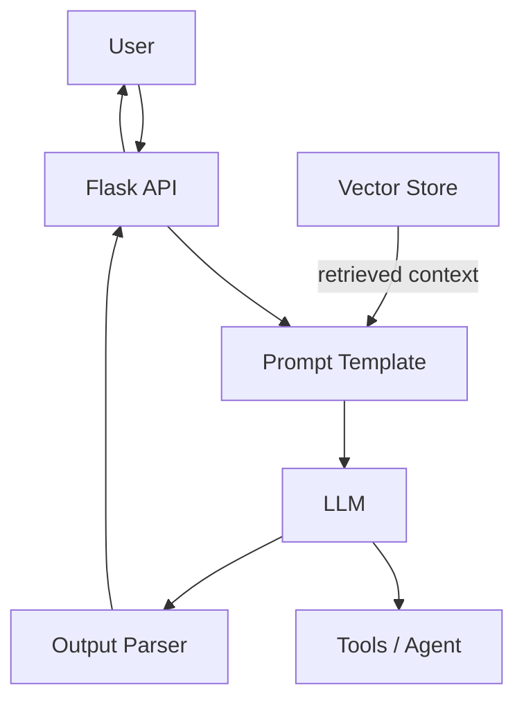

# 🤖 Generative AI & LangChain

<a id="top"></a>

<p align="center">
  <strong>Understand Generative AI, Prompt Engineering, LLMs, LangChain, RAG, AI Agents, and Flask Integration</strong>
</p>

<p align="center">
  
  
  
  
</p>

<a id="about-this-guide"></a>
## 📚 About This Guide

Welcome! This guide explains Generative AI and LangChain from the ground up. It is designed for beginners who want to understand not only what these technologies are, but also how they work, why they are useful, and where they are used in real-world applications.

You do not need prior knowledge of Artificial Intelligence or Large Language Models to begin.

We will progress from basic concepts to building AI-powered applications using Python, LangChain, and Flask.

### 🎯 What you will learn

- The fundamentals of Artificial Intelligence, Machine Learning, NLP, and Generative AI.
- How Large Language Models (LLMs) understand prompts and generate responses.
- What happens inside an LLM: tokenization, embeddings, attention, transformers, training, and inference.
- Prompt engineering techniques, including zero-shot, one-shot, few-shot, and structured prompting.
- How LangChain connects language models, prompts, tools, and output parsers.
- How to build sequential workflows using LangChain Expression Language (LCEL).
- How conversation history and memory can provide context to chatbots.
- How embeddings, vector databases, retrievers, and Retrieval-Augmented Generation (RAG) work.
- How AI agents use tools to complete tasks.
- How to integrate AI models with Python and Flask.
- How to choose, evaluate, and deploy AI models responsibly.

---

<a id="table-of-contents"></a>
## 📑 Table of Contents

- [📚 About This Guide](#about-this-guide)
- [🗺️ Learning Roadmap](#learning-roadmap)
- [🧩 Module 1: Foundations of Artificial Intelligence](#module-1-foundations-of-artificial-intelligence)
- [✍️ Module 2: Prompt Engineering](#module-2-prompt-engineering)
- [🔗 Module 3: Introduction to LangChain](#module-3-introduction-to-langchain)
- [⚙️ Module 4: Chains and LangChain Expression Language (LCEL)](#module-4-chains-and-langchain-expression-language-lcel)
- [🧾 Module 5: Output Parsers and Structured Responses](#module-5-output-parsers-and-structured-responses)
- [💬 Module 6: Conversation History and Memory](#module-6-conversation-history-and-memory)
- [📄 Module 7: Documents, Embeddings, and Vector Databases](#module-7-documents-embeddings-and-vector-databases)
- [🔍 Module 8: Retrieval-Augmented Generation (RAG)](#module-8-retrieval-augmented-generation-rag)
- [🛠️ Module 9: Tools and AI Agents](#module-9-tools-and-ai-agents)
- [🧠 Module 10: AI Models and Model Selection](#module-10-ai-models-and-model-selection)
- [🌐 Module 11: Building a Generative AI Application with Python and Flask](#module-11-building-a-generative-ai-application-with-python-and-flask)
- [🧱 Module 12: Understanding Fine-Tuning and Model Adaptation](#module-12-understanding-fine-tuning-and-model-adaptation)
- [🚀 Module 13: Real-World Project Ideas](#module-13-real-world-project-ideas)
- [🧪 Module 14: Testing, Evaluation, and Responsible AI](#module-14-testing-evaluation-and-responsible-ai)
- [📖 Module 15: Important Terms to Remember](#module-15-important-terms-to-remember)
- [🎤 Module 16: Interview Preparation Questions](#module-16-interview-preparation-questions)
- [🏁 Final Summary](#final-summary)

---

<a id="learning-roadmap"></a>
## 🗺️ Learning Roadmap


Think of this roadmap as learning to build a house: first, understand the materials; next, learn how the components fit together; finally, build a complete application.

> [!TIP]
> The big picture: how every piece in this guide fits together.



---

<a id="module-1-foundations-of-artificial-intelligence"></a>
# 🧩 Module 1: Foundations of Artificial Intelligence

## 1. What is Artificial Intelligence (AI)?

Artificial Intelligence is a field of computer science focused on creating systems that perform tasks normally associated with human intelligence.

Examples include understanding language, recognizing images, recommending products, and predicting outcomes.

## 2. Understanding AI, ML, Deep Learning, NLP, and Generative AI

These terms are related but they do not mean the same thing.

```text
Artificial Intelligence (AI)
    └── Machine Learning (ML)
          └── Deep Learning (DL)
                ├── Natural Language Processing (NLP)
                └── Generative AI (GenAI)
```

## 3. What is a Large Language Model (LLM)?

A Large Language Model is an AI model trained on large amounts of text and other language data to generate and work with human language.

## 4. What is a Foundation Model?

A foundation model is a broadly trained model that can be adapted to many downstream tasks.

## 5. What are Tokens, Context Windows, and Model Parameters?

- Tokens: smaller units of text processed by a model.
- Context window: the maximum input and conversation context the model can use in one request.
- Model parameters: learned values inside the model that influence behavior.
- Inference parameters: generation settings such as temperature and maximum output length.

---

<a id="module-2-prompt-engineering"></a>
# ✍️ Module 2: Prompt Engineering

## 6. What is a Prompt?

A prompt is the instruction or question sent to a model to guide its output.

### Example: weak prompt vs strong prompt

```text
Weak: Tell me about AI.
Strong: Explain AI for a beginner in simple language, include examples, and keep it under 200 words.
```

## 7. The Four Important Parts of a Good Prompt

A strong prompt usually includes:

- clear task
- necessary context
- constraints or format
- examples when useful

## 8. Types of Prompt Engineering

- Zero-shot prompting
- One-shot prompting
- Few-shot prompting
- Step-by-step prompting
- Prompt chaining
- Prompt templates

## 9. Chain-of-Thought and Self-Consistency

These techniques encourage a model to reason more explicitly before answering.

## 10. What is Hallucination in Generative AI?

Hallucination refers to an LLM producing incorrect or invented information confidently.

---

<a id="module-3-introduction-to-langchain"></a>
# 🔗 Module 3: Introduction to LangChain

## 11. What is LangChain?

LangChain is a framework that helps developers build LLM applications by connecting models, prompts, tools, memory, retrievers, and output parsers.

## 12. Important LangChain Components

- Models
- Prompts
- Output parsers
- Chains
- Memory
- Retrievers
- Tools

## 13. Chat Models and Message Types

- System message
- Human message
- AI message
- Tool message

## 14. Creating a PromptTemplate

Prompt templates make it easier to reuse dynamic instructions and inputs.

## 15. Creating a ChatPromptTemplate

Chat prompts are used for multi-turn conversations and messages with roles.

## 16. What is a MessagesPlaceholder?

A `MessagesPlaceholder` lets you insert chat history or user messages dynamically.

---

<a id="module-4-chains-and-langchain-expression-language-lcel"></a>
# ⚙️ Module 4: Chains and LangChain Expression Language (LCEL)

## 17. What is a Chain?

A chain is a sequence of steps used to process input and transform it into an output.

## 18. What is LangChain Expression Language (LCEL)?

LCEL is a compositional way to define runnable chains and pipelines in LangChain.

### Complete example

```python
from langchain.prompts import PromptTemplate
from langchain_core.output_parsers import StrOutputParser
from langchain_openai import ChatOpenAI

prompt = PromptTemplate.from_template("Write a short summary of: {topic}")
llm = ChatOpenAI(model="gpt-4o-mini")
chain = prompt | llm | StrOutputParser()

print(chain.invoke({"topic": "Generative AI"}))
```

### What does `invoke()` do?

It runs the chain with a given input and returns the result.

---

<a id="module-5-output-parsers-and-structured-responses"></a>
# 🧾 Module 5: Output Parsers and Structured Responses

## 19. Why do we need Output Parsers?

LLMs often return text, but applications often need structured JSON or clean values.

## 20. StrOutputParser

This parser returns plain text output.

## 21. JsonOutputParser

This parser converts model output into JSON objects.

---

<a id="module-6-conversation-history-and-memory"></a>
# 💬 Module 6: Conversation History and Memory

## 22. Why does a Chatbot Need Conversation History?

Without memory, chatbots forget previous context and can become repetitive.

## 23. ChatMessageHistory

This tracks earlier messages in a conversation.

## 24. Memory vs. Persistent Storage

- Memory is usually short-term and in-process.
- Persistent storage keeps data across requests or sessions.

---

<a id="module-7-documents-embeddings-and-vector-databases"></a>
# 📄 Module 7: Documents, Embeddings, and Vector Databases

## 25. What is a Document in LangChain?

A document is a chunk of text with metadata that can be processed and retrieved.

## 26. What is a Document Loader?

A document loader reads and normalizes sources such as PDFs, text files, and web pages.

## 27. What is Text Splitting?

Text splitting breaks long documents into manageable chunks for retrieval and embeddings.

## 28. What are Embeddings?

Embeddings convert text into numeric vectors that capture semantic similarity.

## 29. What is a Vector Database?

A vector database stores embeddings and supports similarity search.

---

<a id="module-8-retrieval-augmented-generation-rag"></a>
# 🔍 Module 8: Retrieval-Augmented Generation (RAG)

## 30. What is RAG?

RAG combines retrieval of external information with generation by an LLM.

## 31. The Three Main Steps of RAG

- Retrieval: find relevant information.
- Augmentation: add that context to the prompt.
- Generation: ask the model to answer using the retrieved context.

## 32. What is a Retriever?

A retriever finds the most relevant chunks from a data source.

## 33. What is a Parent Document Retriever?

It retrieves larger source documents and then uses their child chunks for better context.

## 34. What is RetrievalQA?

`RetrievalQA` is a common pattern for question answering over documents.

---

<a id="module-9-tools-and-ai-agents"></a>
# 🛠️ Module 9: Tools and AI Agents

## 35. What is a Tool?

A tool gives an agent a capability such as searching, querying a database, or calling an API.

## 36. Creating a Custom Tool

A custom tool wraps a function and exposes it to the model in a structured way.

## 37. What is an AI Agent?

An AI agent can decide which tool or step to take to complete a task.

## 38. What is the ReAct Pattern?

ReAct combines reasoning and acting by alternating thoughts with tool calls.

## 39. What is AgentExecutor?

`AgentExecutor` runs an agent loop that chooses actions until the task is done.

## 40. What is a Multi-Agent System?

A multi-agent system uses multiple specialized agents that collaborate or compete.

## 41. What is LangGraph?

LangGraph helps build stateful, graph-based agent workflows.

---

<a id="module-10-ai-models-and-model-selection"></a>
# 🧠 Module 10: AI Models and Model Selection

## 42. Why do we need different AI models?

Different models trade off speed, cost, quality, context length, and reasoning ability.

---

<a id="module-11-building-a-generative-ai-application-with-python-and-flask"></a>
# 🌐 Module 11: Building a Generative AI Application with Python and Flask

## 43. What is Flask?

Flask is a lightweight Python web framework used to build APIs and web applications.

## 44. Understanding HTTP Status Codes

A web API uses status codes such as `200`, `201`, `400`, and `500` to communicate results.

## 45. Set Up a Python Project

Create a virtual environment, install dependencies, and structure the app cleanly.

## 46. Create a Simple Flask API

Use Flask routes to accept input and return structured responses.

## 47. Test the API

Exercise the app locally with curl or a frontend client.

## 48. Integrate LangChain with Flask

Connect the API to an LLM, a prompt template, and optional tools or retrieval.

---

<a id="module-12-understanding-fine-tuning-and-model-adaptation"></a>
# 🧱 Module 12: Understanding Fine-Tuning and Model Adaptation

## 49. What is Fine-Tuning?

Fine-tuning adjusts a model on task-specific data to improve performance.

## 50. What are LoRA and QLoRA?

LoRA and QLoRA are efficient fine-tuning methods that reduce adapter size and compute requirements.

---

<a id="module-13-real-world-project-ideas"></a>
# 🚀 Module 13: Real-World Project Ideas

- AI Learning Assistant
- Document Question-Answering Assistant
- AI Customer Support Assistant
- AI Travel Planner
- AI Mobile Application Backend

---

<a id="module-14-testing-evaluation-and-responsible-ai"></a>
# 🧪 Module 14: Testing, Evaluation, and Responsible AI

## 51. What should you test?

- Functional testing
- Input validation
- Model quality
- Retrieval quality
- Structured output
- Security
- Performance and cost

## 52. Common Risks and Mitigations

Monitor hallucinations, data leakage, prompt injection, and expensive token usage.

---

<a id="module-15-important-terms-to-remember"></a>
# 📖 Module 15: Important Terms to Remember

- Token
- Embedding
- Context window
- Inference
- Temperature
- Retrieval
- Agent
- Fine-tuning

---

<a id="module-16-interview-preparation-questions"></a>
# 🎤 Module 16: Interview Preparation Questions

Prepare for questions about LLM internals, prompting, LangChain, RAG, AI agents, and deployment.

---

<a id="final-summary"></a>
# 🏁 Final Summary

Generative AI and LangChain are powerful tools, but the most impactful applications combine strong engineering practices with careful evaluation, secure design, and practical product thinking.

The best way to learn is to build real projects, iterate quickly, and verify outputs against trusted sources.

---

## 🔗 Further Learning Resources

- OpenAI Documentation
- LangChain Documentation
- Hugging Face Learn
- DeepLearning.AI
- Anthropic Docs


<!--
The anchor links above are explicit and stable, so the table of contents works reliably in GitHub and markdown renderers.
The Mermaid diagrams below intentionally avoid HTML labels like <br/> to reduce rendering flicker in stricter Markdown viewers.
-->
